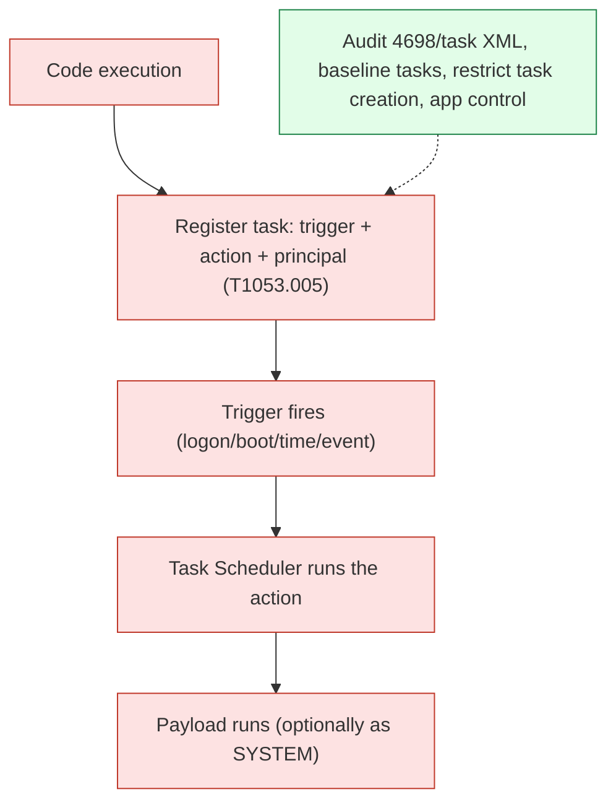

# Scheduled Task Persistence

## Summary

The Windows Task Scheduler runs programs on a trigger: at a set time, at logon or boot, on idle, or on an event. Attackers register a task that launches their payload on such a trigger, giving them persistence that survives reboots and can run with elevated or SYSTEM privileges (scheduled task/job: scheduled task, T1053.005). Tasks are flexible and look administratively normal, which is why they are a favourite both for persistence and for privilege escalation (a task configured to run as SYSTEM). Tasks can be created with `schtasks.exe`, the `ScheduledTasks` PowerShell module, or the Task Scheduler API, and are stored as XML under `C:\Windows\System32\Tasks` with matching registry entries.

## How task persistence works

| Element | Role |
|---|---|
| **Trigger** | When it runs: time, logon, boot, idle, or an event ID |
| **Action** | What runs: an executable, script, or LOLBin command |
| **Principal** | Which identity it runs as (a user, or SYSTEM/highest privileges) |
| **Storage** | Task XML in `System32\Tasks` plus keys under `...\Schedule\TaskCache` |

Running as SYSTEM or "with highest privileges" is what turns a persistence task into an escalation; an attacker who can create such a task from an admin context gains a reliable SYSTEM foothold.

## Persistence flow

## Detection

- Task creation and modification events (4698 created, 4702 updated, plus 4699/4700/4701) outside change windows.
- New task XML files in `C:\Windows\System32\Tasks` and changes under the `TaskCache` registry keys.
- `schtasks.exe` or PowerShell task cmdlets spawned by unusual parents (Office apps, scripts, web processes).
- Tasks whose action is a LOLBin, script, or binary in a user-writable path, or that run as SYSTEM unexpectedly.

## Defense

- **Enable Task Scheduler auditing** (4698/4702) and alert on new tasks, especially SYSTEM/highest-privilege ones.
- **Baseline scheduled tasks** and compare against a known-good inventory.
- **Restrict who can create tasks** and limit interactive admin where possible.
- **Application control** so a task cannot execute an unapproved binary.
- Investigate the creating process and the task's action, not just the task's presence.

## ATT&CK mapping

| ID | Name | Tactic |
|---|---|---|
| T1053.005 | Scheduled Task/Job: Scheduled Task | Execution, Persistence, Privilege Escalation |

## Explanation

The Task Scheduler is Windows's built-in alarm clock: tell it "run this program every morning" or "run this at the next logon" and it obliges, even with administrator rights if asked. For an attacker that is almost ideal persistence — it is a normal, documented feature, it survives reboots, and it can run as SYSTEM. The defence leans on the fact that creating a task leaves a record: the system logs it, writes an XML file, and updates the registry. Keeping an inventory of legitimate tasks and alerting on new ones, particularly those that run with the highest privileges, turns the attacker's convenient alarm clock into an easy tripwire.
