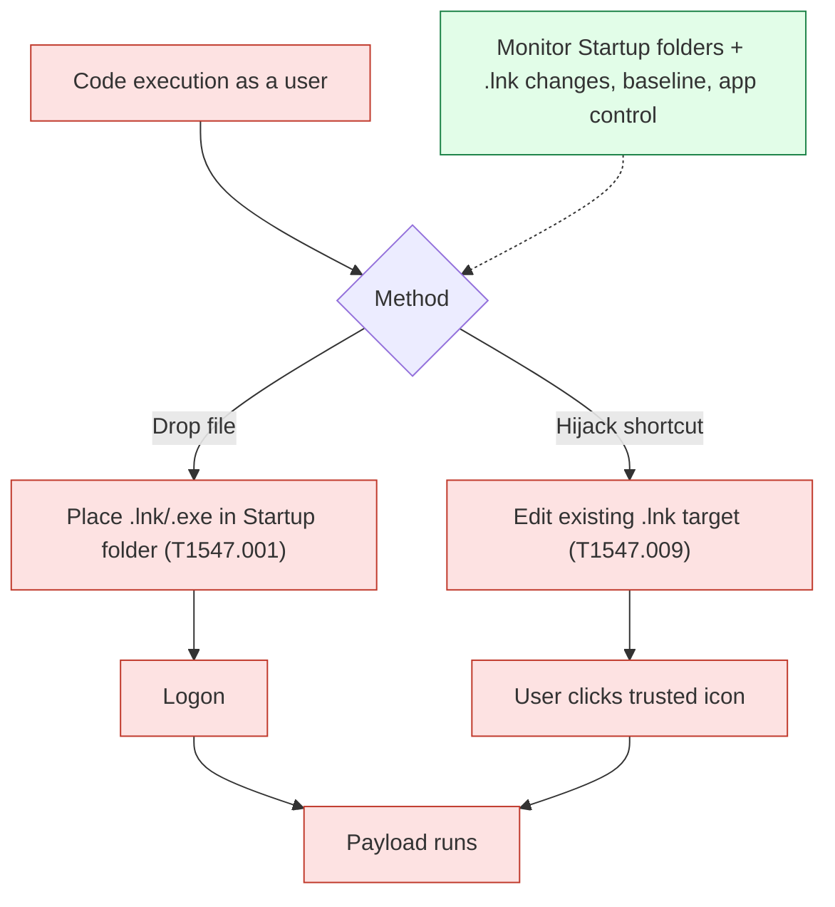

# Startup Folder and Shortcut (LNK) Persistence

## Summary

Windows automatically launches anything placed in the Startup folder when a user logs in. Dropping a shortcut or executable there is one of the oldest and simplest persistence methods, and the per-user folder needs no administrator rights (boot or logon autostart execution: registry run keys / startup folder, T1547.001). A related technique modifies an existing, trusted shortcut (`.lnk`) so that it quietly launches the attacker's payload alongside or instead of the program the user expected (shortcut modification, T1547.009). Both rely on Windows following a pointer the attacker controls, and both are easy to spot once you know where to look.

## The two locations/techniques

| Technique | Where |
|---|---|
| **Per-user Startup** | `%AppData%\Microsoft\Windows\Start Menu\Programs\Startup` (no admin) |
| **All-users Startup** | `%ProgramData%\Microsoft\Windows\Start Menu\Programs\Startup` (needs admin) |
| **Shortcut modification (T1547.009)** | Edit a `.lnk` target/arguments so a trusted icon runs malware |

A startup `.lnk` is attractive because the folder is small and rarely changes, yet it is checked on every logon; a modified shortcut is stealthier because the user keeps clicking what looks like their normal app.

## Persistence flow

## Detection

- New files appearing in the per-user or all-users Startup folders (file-creation monitoring).
- Changes to existing `.lnk` targets or arguments, particularly pointing to scripts, LOLBins, or user-writable paths.
- Shortcuts whose target does not match their displayed name/icon.
- The writing process being an Office app, archive extractor, browser download, or script interpreter.

## Defense

- **Monitor the Startup folders and shortcut files** for creation and modification.
- **Baseline** the expected contents of both Startup folders and alert on deviations.
- **Application control** so a dropped or hijacked shortcut cannot run an unapproved binary.
- **User-awareness and mail/web filtering** to reduce malicious `.lnk` delivery.
- Inspect suspicious `.lnk` targets/arguments rather than trusting the icon.

## ATT&CK mapping

| ID | Name | Tactic |
|---|---|---|
| T1547.001 | Boot or Logon Autostart Execution: Registry Run Keys / Startup Folder | Persistence, Privilege Escalation |
| T1547.009 | Boot or Logon Autostart Execution: Shortcut Modification | Persistence, Privilege Escalation |

## Explanation

The Startup folder is a literal in-tray: Windows runs whatever you leave in it the next time you log in, and your own in-tray needs nobody's permission. So the simplest persistence is to drop a shortcut there. The sneakier cousin is to leave your real shortcuts alone but rewrite where one of them points, so the familiar icon on the desktop now quietly starts your program too. Both tricks come down to Windows faithfully following a pointer you were allowed to set, which means the defence is equally simple: watch those few, well-known folders and the shortcut files, and anything new or changed is worth a look.
