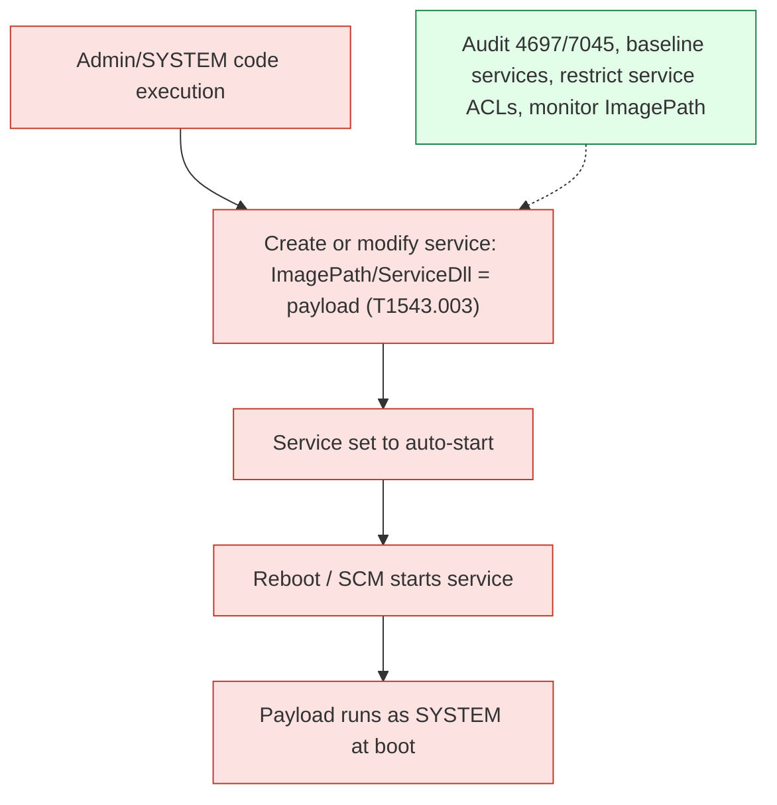

# Windows Service Persistence

## Summary

A Windows service is a background program that the Service Control Manager (SCM) can start automatically at boot, before any user logs in, typically running as SYSTEM. Creating a new service, or hijacking an existing one, gives an attacker persistence that is both durable (it survives reboots and logoffs) and privileged (SYSTEM by default) — create or modify system process: Windows service, T1543.003. Services can be installed with `sc.exe`, the `New-Service` cmdlet, or the service API, and are defined by keys under `HKLM\SYSTEM\CurrentControlSet\Services`. Because this method requires administrator rights to install a service, it usually appears after an attacker has already escalated, as a way to keep that access.

## How service persistence works

| Approach | Mechanism |
|---|---|
| **Create a new service** | Register a service with `Start=auto` whose `ImagePath` is the payload |
| **Modify an existing service** | Repoint a legitimate service's `ImagePath`/`binPath` to malicious code |
| **Service DLL (svchost)** | Point a shared-process service's `ServiceDll` (`Parameters` key) at a malicious DLL |
| **Failure/recovery actions** | Abuse a service's recovery command to run on crash |

Running as SYSTEM and starting automatically at boot are what make services valuable for persistence; the ServiceDll variant is stealthier because the malware runs inside a trusted `svchost.exe`.

## Persistence flow

## Detection

- Service installation events (4697 security log, 7045 system log) for new or unusual services.
- Changes to `ImagePath`, `ServiceDll`, or start-type values under the Services registry key.
- Services whose binaries live in user-writable or temporary paths, or that are unsigned.
- A `svchost.exe` loading an unexpected or unsigned `ServiceDll`.

## Defense

- **Enable service-install auditing** (4697/7045) and alert on new services, especially unsigned or oddly-pathed ones.
- **Baseline installed services** and compare regularly.
- **Restrict ACLs** on the Services registry keys and on service binaries so standard users cannot modify them.
- **Application control and driver/binary signing** so a service cannot run unapproved code.
- Investigate the installing process and the service binary, not just the service name.

## ATT&CK mapping

| ID | Name | Tactic |
|---|---|---|
| T1543.003 | Create or Modify System Process: Windows Service | Persistence, Privilege Escalation |

## Explanation

Services are the staff Windows keeps on permanently — they clock in automatically at boot, before anyone logs in, and most of them carry a SYSTEM pass. If an attacker can hire a new member of staff or swap the duties of an existing one, they have someone with top-level access showing up for work after every restart. The quietest version doesn't even create a new employee; it rewrites the job of one already trusted (a malicious ServiceDll inside svchost). Installing a service leaves a clear paper trail in the event log and registry, so defenders keep a staff roster: a new or altered service, particularly one running from an odd location, is the thing to question.
