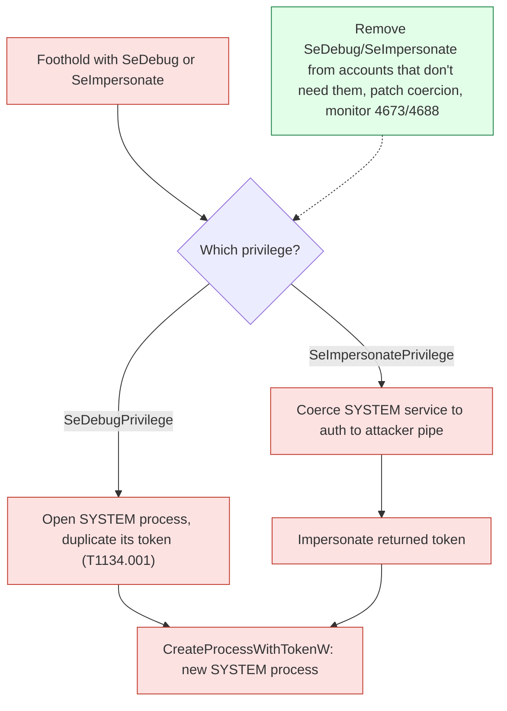

# Token Impersonation and SeDebugPrivilege / SeImpersonate Abuse

## Summary

Every Windows process carries an access token describing the identity and privileges it runs with. An attacker who already has some rights can escalate by stealing or duplicating a more privileged token and attaching it to their own process or thread, so the new process acts as SYSTEM or another user (access token manipulation: token impersonation/theft, T1134.001). Two privileges make this easy: **SeDebugPrivilege** lets a process open almost any other process (including SYSTEM processes) and read its token, and **SeImpersonatePrivilege** lets a process impersonate a token handed to it over a named pipe or RPC — the basis of the "Potato" family of local escalations. The token, not the password, is the credential being abused.

## How token abuse works

| Mechanism | What happens |
|---|---|
| **Token theft (SeDebug)** | Open a SYSTEM process, duplicate its token, and spawn a process with it (`CreateProcessWithTokenW`) |
| **Token impersonation (SeImpersonate)** | Coerce a SYSTEM service to authenticate to an attacker-controlled pipe, then impersonate the resulting token |
| **Primary vs impersonation token** | Duplicate an impersonation token to a primary token (`DuplicateTokenEx`) to launch a new process as that identity |

The reason SeImpersonate is dangerous: service accounts (like those running web or database services) often hold it, so a web-shell as a low-privileged service account can still reach SYSTEM by tricking a privileged service into authenticating to it.

## Attack flow

## Detection

- Sensitive-privilege use events (4673/4674) for SeDebugPrivilege by unexpected processes.
- A low-privileged service account spawning a SYSTEM child process (4688), especially from web/database service parents.
- Local named-pipe authentication patterns consistent with coercion ("Potato"-style) followed by a privileged process launch.
- Processes calling `CreateProcessWithTokenW`/`CreateProcessAsUser` outside normal administrative tooling.

## Defense

- **Remove excessive privileges**: SeImpersonate and SeDebug should belong only to accounts that genuinely need them; audit service accounts.
- **Patch authentication-coercion vectors** that the impersonation attacks rely on.
- **Use virtual/managed service accounts and least privilege** for services exposed to untrusted input.
- **Enable Credential Guard and LSASS protection** so stolen tokens have less to reach.
- **Monitor** sensitive-privilege use and anomalous SYSTEM child processes.

## ATT&CK mapping

| ID | Name | Tactic |
|---|---|---|
| T1134 | Access Token Manipulation | Privilege Escalation, Stealth |
| T1134.001 | Access Token Manipulation: Token Impersonation/Theft | Privilege Escalation, Stealth |

## Explanation

A Windows token is like a wristband that says who you are and what you are allowed to do; the system checks the wristband, not your face. If you can copy someone else's wristband, you become them. SeDebugPrivilege is a master key that lets you reach into almost any running program and photocopy its wristband — including SYSTEM's. SeImpersonate is subtler: it lets you wear a wristband that someone hands you, so the trick is to fool a powerful service into handing you its own. Either way the escalation is about wristbands, so the defence is to give those two master-key privileges to as few accounts as possible.
