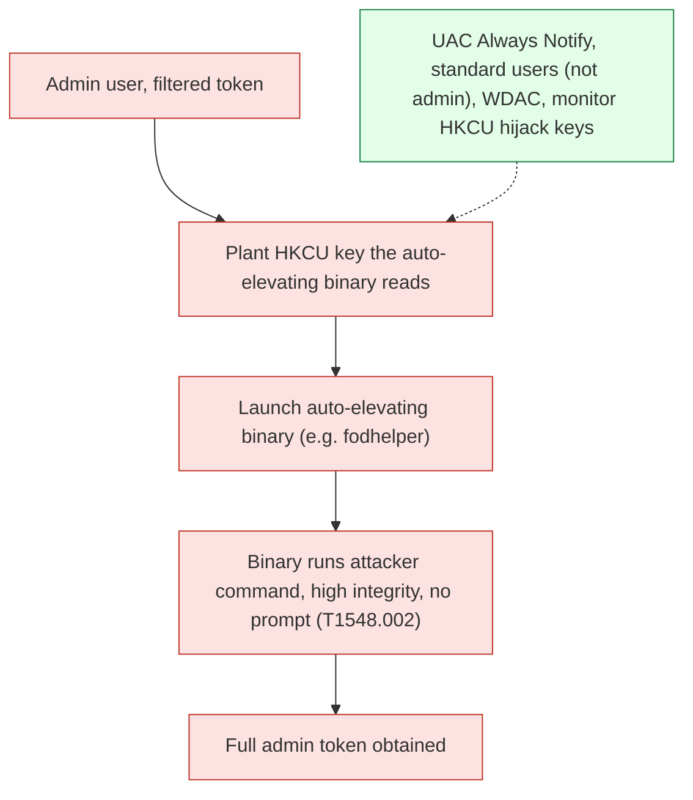

# UAC Bypass Techniques (fodhelper and Token Abuse)

## Summary

User Account Control (UAC) lets an administrator run most of the time with a filtered (standard) token, elevating to the full admin token only on consent. UAC bypasses let code elevate to the full token **without** prompting the user, typically by abusing auto-elevating system binaries that run high-integrity without a prompt (abuse elevation control mechanism: bypass UAC, T1548.002). The classic `fodhelper` technique hijacks a registry key that the auto-elevating binary reads, so it launches the attacker's command elevated. UAC is a convenience boundary, not a strong security boundary, which is why Microsoft does not treat every bypass as a serviced vulnerability.

## How bypasses work

| Approach | Mechanism |
|---|---|
| **Auto-elevate hijack (fodhelper)** | Write a crafted `HKCU` registry key the auto-elevating binary reads, so it runs your command elevated |
| **Trusted-directory / DLL** | Trick an auto-elevating process into loading an attacker DLL or running from a trusted path |
| **Token abuse** | Manipulate or duplicate a high-integrity token to spawn an elevated process |
| **Environment/registry redirection** | Redirect what an auto-elevating process executes |

The common thread: certain signed Windows binaries elevate silently, and if an attacker can influence what they run (usually via a per-user registry key), they inherit that silent elevation.

## Attack flow

## Detection

- Writes to the specific `HKCU` registry keys abused by known bypasses (fodhelper, eventvwr, sdclt, etc.).
- Auto-elevating system binaries spawning unexpected child processes (cmd/PowerShell) at high integrity.
- A medium-integrity process leading to a high-integrity child without a consent prompt.
- Known UAC-bypass tool patterns and the registry-key cleanup that often follows.

## Defense

- **Do not run as administrator** for daily work; standard users cannot silently self-elevate, which removes most bypasses.
- **Set UAC to "Always Notify"**, the strongest setting, so elevation is harder to do silently.
- **Monitor the hijack registry keys** and auto-elevating binaries spawning shells.
- **Application control (WDAC/AppLocker)** to stop unauthorised elevated execution.
- Treat UAC as defence-in-depth, not a boundary: combine with least privilege and EDR.

## ATT&CK mapping

| ID | Name | Tactic |
|---|---|---|
| T1548.002 | Abuse Elevation Control Mechanism: Bypass User Account Control | Privilege Escalation |

## Explanation

UAC is the prompt that asks "are you sure you want to run this as administrator?" To make life bearable, Windows lets a handful of its own trusted tools skip that prompt and elevate automatically. UAC bypass is tricking one of those trusted tools into running your command instead of its own — usually by leaving a note in a place the tool checks (a per-user registry key) — so it quietly hands you administrator rights with no prompt at all. The simplest defence is not to be an administrator in the first place: a standard user has nothing to silently elevate to, and the whole class of tricks falls flat.
