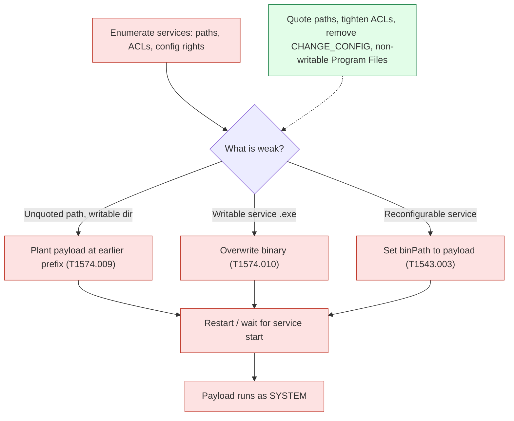

# Unquoted Service Paths and Weak Service Permissions

## Summary

Windows services usually run as SYSTEM, so any way to control what a service executes is a direct path to the highest privilege. Two common misconfigurations provide that control. An **unquoted service path** with spaces (e.g. `C:\Program Files\My App\svc.exe`) makes the service control manager try `C:\Program.exe`, then `C:\Program Files\My.exe`, before the real binary — so an attacker who can write to one of those earlier paths gets their binary run as SYSTEM (path interception by unquoted path, T1574.009). **Weak service permissions** are even more direct: if a low-privileged user can reconfigure a service's binary path (`SERVICE_CHANGE_CONFIG`) or overwrite the service executable (weak file ACL, T1574.010), they point it at their own payload and restart it as SYSTEM (T1543.003). Both are quiet because they need no exploit.

## The misconfigurations

| Weakness | Why it escalates |
|---|---|
| **Unquoted path + writable intermediate dir** | SCM tries each space-separated prefix as an executable; a writable prefix dir lets you plant one |
| **Writable service binary (weak ACL)** | Overwrite the `.exe` the service runs; it executes as SYSTEM on next start (T1574.010) |
| **`SERVICE_CHANGE_CONFIG` granted to users** | Reconfigure `binPath` to any command, then start/restart the service (T1543.003) |
| **Writable service registry key** | Edit `ImagePath` under the service's `HKLM\SYSTEM\CurrentControlSet\Services` key |

The common requirement is a write primitive the attacker already has (a writable folder, file, or registry key, or a service-config right) that intersects what a SYSTEM service runs.

## Attack flow

## Detection

- Service configuration changes (event 7040, and 4697 service installation) outside change windows or management tooling.
- New or modified executables in service binary directories, especially writable `Program Files` subfolders.
- A service starting an unexpected child (cmd/PowerShell) at SYSTEM integrity.
- Writes to `ImagePath` values under the Services registry key by non-admin processes.

## Defense

- **Quote every service path** so the SCM cannot interpret intermediate prefixes.
- **Tighten ACLs** on service binaries, their directories, and the Services registry keys so standard users cannot write.
- **Remove `SERVICE_CHANGE_CONFIG`** and other dangerous service rights from non-administrators (audit with service-ACL tools).
- **Keep program directories non-writable** by standard users; avoid installing into world-writable paths.
- **Monitor** service installs, config changes and new service binaries.

## ATT&CK mapping

| ID | Name | Tactic |
|---|---|---|
| T1574.009 | Hijack Execution Flow: Path Interception by Unquoted Path | Execution, Stealth |
| T1574.010 | Hijack Execution Flow: Services File Permissions Weakness | Execution, Stealth |
| T1543.003 | Create or Modify System Process: Windows Service | Persistence, Privilege Escalation |

## Explanation

A Windows service is a program the system runs for you, usually with the highest rights, so whoever decides which file the service runs effectively owns the machine. An unquoted path with a space is like an address written without brackets: the system reads it greedily and may knock on the wrong door first, and if an attacker owns that door, their program answers as SYSTEM. Weak permissions are blunter still: if you are allowed to swap the service's program file or rewrite its address, you simply point it at your own code and restart it. The fixes are unglamorous but complete: quote the addresses, and make sure ordinary users cannot write to the files, folders or settings that decide what a service runs.
