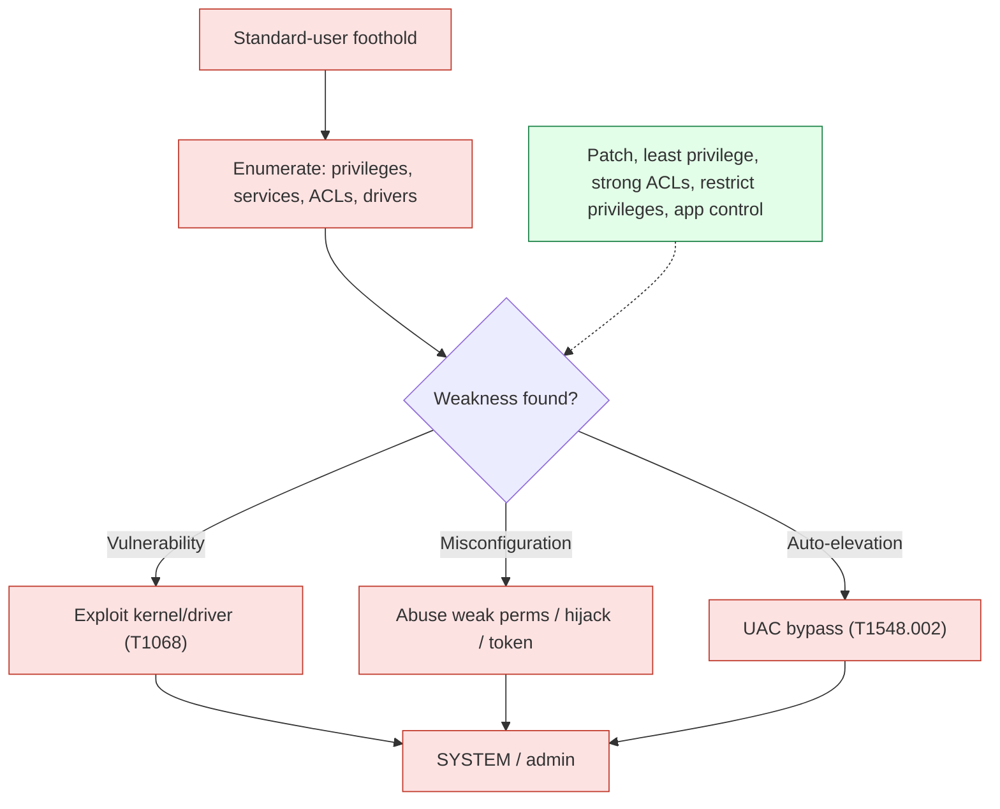

# Windows Privilege Escalation Techniques

## Summary

Privilege escalation is moving from the access an attacker has to the access they want — typically from a standard user to local administrator or SYSTEM. On Windows it falls into two broad families: **exploiting a vulnerability** (a kernel or driver bug that grants SYSTEM, T1068) and **abusing a misconfiguration** (weak permissions, hijackable paths, excessive privileges). This file is the map of the territory; individual techniques (UAC bypass, unquoted paths, token abuse, DLL hijacking, service misconfig) each have their own detailed treatment.

## The two families

| Family | Examples |
|---|---|
| **Exploitation** | Kernel/driver vulnerabilities (T1068), vulnerable signed drivers (BYOVD) |
| **UAC bypass** | Auto-elevating binaries, trusted-directory tricks (T1548.002) |
| **Weak permissions** | Writable service binaries/registry, unquoted service paths, weak file/folder ACLs |
| **Hijackable execution** | DLL search-order and path hijacking (T1574) |
| **Token/privilege abuse** | SeImpersonate/SeDebug misuse to adopt SYSTEM tokens |
| **Credential-based** | Stored admin credentials, autologon secrets reused to elevate |

Most real-world escalation is misconfiguration abuse, because it needs no exploit and is quiet — which is why enumeration (what is writable, what runs as SYSTEM, what privileges are held) is the attacker's first step.

## Escalation flow

## Detection

- Enumeration of privileges, services, writable paths and installed drivers shortly after a foothold.
- Loading of vulnerable or unusual signed drivers (BYOVD), and kernel-exploit crash/behaviour signatures.
- A standard process spawning a SYSTEM/elevated child, or token manipulation to a higher context.
- UAC-bypass indicators (auto-elevating binaries invoked oddly, registry hijacks for elevation).

## Defense

- **Patch** the OS, drivers and third-party software to close exploitation routes, and block known-vulnerable drivers.
- **Least privilege**: avoid giving standard users admin, and remove excessive privileges (SeImpersonate/SeDebug) from accounts that do not need them.
- **Fix misconfigurations**: strong ACLs on service binaries/registry, quoted service paths, non-writable program directories.
- **Enforce UAC at the highest level** and application control (WDAC/AppLocker).
- **Monitor** for escalation enumeration, driver loads, and elevated child processes.

## ATT&CK mapping

| ID | Name | Tactic |
|---|---|---|
| T1068 | Exploitation for Privilege Escalation | Privilege Escalation |
| T1548.002 | Abuse Elevation Control Mechanism: Bypass User Account Control | Privilege Escalation |
| T1574 | Hijack Execution Flow | Execution, Stealth |

## Explanation

Getting a foothold as an ordinary user is like being let into the lobby; privilege escalation is reaching the management floor. There are two ways up: force a locked door with a known structural flaw (exploit a vulnerability), or find a door someone left unlocked (a misconfiguration) — a cleaning-cupboard key that happens to open the executive suite, a lift that auto-stops at the top. Attackers almost always check for unlocked doors first, because it is quieter and needs no tools. Defenders win by patching the structural flaws and, above all, by not leaving doors unlocked: least privilege, tight permissions, and app control.
