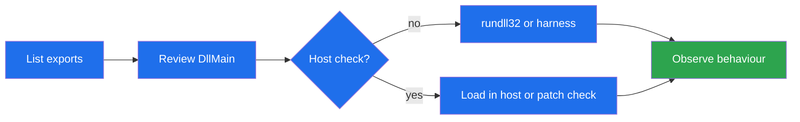

# Analyzing Malicious DLLs (Exports, rundll32, Host Processes)

## Summary

A large share of Windows malware ships as a DLL rather than an EXE: as a loader's second stage, as a hijacked library dropped next to a legitimate program (T1574.001), or as a plug-in loaded by a service. A DLL cannot run by itself; something has to load it and call into it. So the first analysis question is always "how is this DLL meant to be started, and by what?". The answer decides how you run it in a sandbox or debugger.

## Step 1: read the exports

The export table lists the functions the DLL offers to callers. `dumpbin /EXPORTS file.dll` (from the MSVC tools) or any PE viewer will show it. What to look for:

- **Names that suggest an entry point**: `ServiceMain`, `DllRegisterServer`, `Start`, `Run`, or a single oddly named export.
- **Names that copy a real system DLL**: a sign of DLL hijacking or proxying; compare with the genuine DLL's exports.
- **No meaningful exports at all**: the payload probably runs from `DllMain` as soon as the DLL is loaded.

## Step 2: understand DllMain

`DllMain` is the optional entry point the loader calls when the DLL is loaded or unloaded and when threads start or exit. With `DLL_PROCESS_ATTACH` it runs as the DLL is mapped into a process, at process start-up or via `LoadLibrary`. Malware frequently does its work, or starts a thread to do it, right here. If `DllMain` returns `FALSE` during `LoadLibrary`, the load fails and `LoadLibrary` returns NULL.

## Step 3: run it

| Method | When to use |
|---|---|
| `rundll32 file.dll,ExportName` | The DLL has an export written to be called this way. Microsoft notes that rundll32 can only call functions written for it; the printui example shows the `dll,EntryPoint` form. |
| Load it with a small harness (`LoadLibrary` + `GetProcAddress`) | You need to pass real arguments, or call several exports in order |
| Let a debugger load it | x64dbg can load DLLs directly and has **DLL breakpoints** that pause when a named DLL is loaded or unloaded |
| Load it into its intended host | The DLL only works inside a specific process (see below) |

## Step 4: deal with host-process checks

Some DLLs refuse to run unless they are inside a particular process, for example a specific service host or browser. A common way is to call `GetModuleFileName` with a NULL module handle (which returns the path of the process executable) and compare the name. Options: run the DLL inside the expected host in a lab VM, rename your loader to match, or patch the comparison in a debugger.

## Detection notes

- `rundll32.exe` launching a DLL from a user-writable folder, or with an unusual or numeric export, is a classic signal (T1218.011).
- A DLL with the same name as a system DLL in an application folder suggests search-order hijacking (T1574.001).
- Process creation logging with command lines (Security event 4688 with command-line auditing, or Sysmon) captures the rundll32 arguments.

## ATT&CK mapping

- **T1218.011 Rundll32**: proxy execution of DLL code through a signed Windows binary.
- **T1129 Shared Modules**: malicious code delivered as a loadable module.
- **T1574.001 DLL**: hijacking or side-loading so a legitimate program loads the malicious DLL.

## Explanation

A DLL is a cassette tape with no player of its own. Before you can listen, you need to know which player it fits (the host), which track to press play on (the export), and whether it starts playing the moment you insert it (DllMain).
