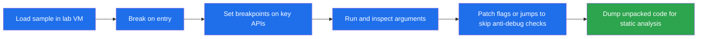

# Debugging Malware (Breakpoints and Stepping)

## Summary

Static analysis shows what a sample *could* do; a debugger shows what it *does*. By running the sample under control, an analyst can stop at chosen points, read registers, memory and the stack, follow decrypted strings as they appear, and change execution to skip anti-analysis checks. Packed malware in particular is often easier to handle by letting it unpack itself in a debugger and then dumping the result. Always debug malware in an isolated lab VM: the code really runs.

## Controlling execution

| Action | What it does |
|---|---|
| **Step into** | Execute one instruction; if it is a call, stop at the first instruction of the callee |
| **Step over** | Execute one instruction; if it is a call, run the whole callee and stop after it returns |
| **Run to return** | Continue until the current function returns |
| **Run / continue** | Run until the next breakpoint or exception |

## Breakpoint types

| Type | How it works | Trade-off |
|---|---|---|
| **Software breakpoint** | The debugger temporarily replaces the instruction at the address with a break instruction (on x86/x64, `INT3`, one-byte opcode `0xCC`) and remembers the original byte | Unlimited in number, but changes code bytes, so self-checksumming code can notice it; cannot be placed in code that can't be overwritten |
| **Processor (hardware) breakpoint** | Stored in the CPU debug registers; triggers on execute, read/write, or write of an address range (WinDbg `ba`) | Does not modify code, but only a few exist (x86/x64 has four breakpoint address registers, `DR0`-`DR3`; `DR6` reports which condition fired and `DR7` sets each breakpoint's type and size) |
| **Memory (page) breakpoint** | The debugger marks a whole memory region as a guard page, so any chosen kind of access (read, write, execute) faults (x64dbg `bpm`) | Good for "stop when anything executes in this newly unpacked region" |
| **Conditional breakpoint** | Any of the above, plus a condition the debugger evaluates before stopping | Useful on hot functions, e.g. stop on `CreateFileW` only when the name ends in `.exe` |

Microsoft's WinDbg documentation explains that `bp`, `bu` and `bm` create software breakpoints by inserting a break instruction, so to break in read-only code you must use `ba` with the execute option. Execute breakpoints set with `ba` must have a size of 1.

## Exceptions: first and second chance

When the debuggee raises an exception, the debugger gets the **first chance** to see it before any of the program's own handlers run. If the debugger passes it on and no handler in the program deals with it, the debugger gets a **second chance**; at that point the process is about to terminate. Malware sometimes uses deliberate exceptions as an anti-debugging trick, so configure the debugger to pass expected exceptions back to the program.

## Changing execution (patching)

To get past a check such as `IsDebuggerPresent`, an analyst can change the return value in `EAX`/`RAX`, flip the zero flag before a conditional jump, set the instruction pointer past the check, or overwrite the jump in memory. Record every change so results are reproducible.

## Tools

- **x64dbg**: common open-source user-mode debugger for 32- and 64-bit Windows.
- **WinDbg**: Microsoft's debugger; required for kernel-mode debugging (drivers, rootkits).
- **OllyDbg**: older 32-bit debugger that appears in many classic tutorials.
- **IDA / Ghidra**: disassemblers that also integrate debugging.

## Security relevance

Malware commonly checks for debuggers (T1622 Debugger Evasion), times its own execution, or scans its code for `0xCC` bytes. Knowing how each breakpoint type works tells you which ones a given check can see: a self-checksum catches software breakpoints but not processor breakpoints.

## ATT&CK mapping

- **T1622 Debugger Evasion**: the anti-debugging checks analysts must work around.

## Explanation

Running malware normally is watching a film at full speed. A debugger gives you the remote: pause, frame-by-frame, rewind to a bookmark, and even edit a scene so the character takes the other door. A software breakpoint is a sticky note on the film reel (the film can notice it); a hardware breakpoint is a timer on the projector (the film can't).
