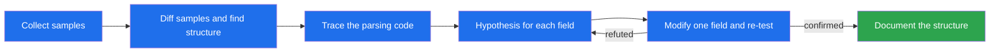

# Deciphering File Formats and Undocumented Software Interfaces

## Summary

Code reversing asks "what does this program do?". **Data reversing** asks a different question: "how is this data laid out?". The target is an undocumented file format, a proprietary network protocol, or an undocumented API that a program uses internally. The analyst recovers fields, lengths, types, flags and checksums by comparing real samples and by watching the code that reads and writes them. The same skill set is used for interoperability work, for vulnerability research (a parser is only as safe as its handling of every field), and for malware analysis, where samples hide configuration and command-and-control traffic in custom formats (T1001 Data Obfuscation, T1027 Obfuscated Files or Information).

## How the work proceeds

| Step | What the analyst does | Why |
|---|---|---|
| **Collect samples** | Gather many files or captures produced under known conditions | Differences between samples reveal which bytes carry meaning |
| **Diff and spot structure** | Look for magic values, length prefixes, repeating record sizes, offsets that point elsewhere in the file | Most formats are a header plus tables or records |
| **Trace the parser** | Find the code that reads the data (file-read or socket-receive calls), then follow how each value is used | The code is the ground truth for a field's type and limits |
| **Form a hypothesis per field** | "Offset 0x10 is a 32-bit record count", and so on | Keeps the work testable |
| **Change one thing at a time** | Edit a single field, feed it back, observe the result | Confirms or refutes each hypothesis |
| **Write it down** | Record the structure as a table or a C struct as you go | The recovered spec is the deliverable |

A documented format is a useful reference point. Microsoft's PE/COFF specification, for example, shows the usual building blocks of a binary format: a signature, fixed-size headers, a table of section headers, and fields that give offsets and sizes of other parts of the file.

## Undocumented interfaces

The same approach applies to undocumented functions and messages inside a product: identify the call sites, recover the parameter layout from how callers fill it in, then confirm by calling it yourself in a test harness. Expect undocumented interfaces to change between versions without notice.

## Security relevance

- **Malware analysis**: custom C2 protocols and encrypted configuration blobs must be decoded before you can write network signatures or extract indicators.
- **Vulnerability research**: once the format is known, every length and count field becomes a fuzzing target.
- **Detection engineering**: a recovered format lets you write parsers and YARA-style rules for it.

## Legal note

Reversing for interoperability or security research is treated differently from reversing to defeat copy protection, and the rules differ by country. Check the legal position and any licence terms before reversing a commercial product. This page gives no legal advice.

## Practical rules

- Work from several samples and vary one field at a time.
- Prefer reading the parser over guessing from bytes alone.
- Keep the recovered structure under version control alongside test samples.

## ATT&CK mapping

- **T1001 Data Obfuscation**: custom encodings in C2 traffic, which this skill decodes.
- **T1027 Obfuscated Files or Information**: hidden configuration and payload formats.

## Explanation

Imagine finding a stack of forms in a language you can't read. You can still work out that the top-right box is always a date, that the third line is always a number that matches how many rows follow, and that the last box changes whenever anything else changes (a checksum). Change one box, hand the form to the clerk, and see what they do. Eventually you can fill in the form yourself.
