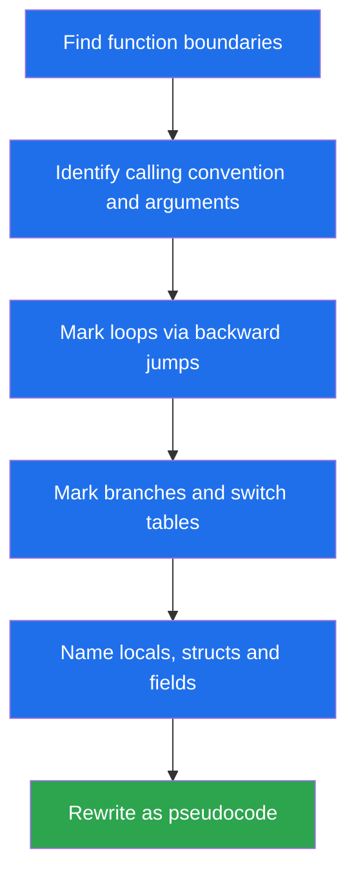

# Recognizing C Code Constructs in Assembly

## Summary

Reading a disassembly one instruction at a time is slow. Compilers turn the same high-level constructs into the same few shapes, so an analyst who recognises the shapes can read a function as "a loop over an array with an early exit" rather than as forty instructions. This page lists the common shapes for 32-bit and 64-bit x86 code produced by C and C++ compilers. Exact output varies with compiler and optimisation level, so treat these as patterns to look for, not rules.

## Common shapes

| C construct | What it usually looks like |
|---|---|
| **Global variable** | Accessed through a fixed address (or, in 64-bit code, an address relative to the instruction pointer) |
| **Local variable / argument** | Accessed at an offset from the frame or stack pointer (`EBP`/`ESP`, `RBP`/`RSP`) |
| **if / else** | `cmp` or `test`, then a conditional jump around the "then" block; an unconditional jump skips the "else" |
| **for loop** | Initialise a counter, jump to a compare, body, increment, then a backward jump to the compare |
| **while loop** | Like `for` but without the counter set-up |
| **switch** | Either a chain of compares, or a bounds check followed by an indirect jump through a **jump table** indexed by the case value |
| **Array access** | Base address plus index multiplied by the element size |
| **Struct field** | Base pointer plus a constant offset |
| **Linked list walk** | Loop that loads the next pointer from a fixed offset in the current node until it is zero |

## Calling conventions

Knowing the convention tells you where to find arguments and who cleans the stack.

| Convention | Platform | Arguments | Stack cleanup |
|---|---|---|---|
| `__cdecl` | x86 | Pushed right to left | Caller |
| `__stdcall` | x86 | Pushed right to left | Callee |
| `__fastcall` | x86 | First two DWORD-or-smaller arguments in `ECX` and `EDX`, rest pushed right to left | Callee |
| `__thiscall` | x86 | Pushed right to left; the C++ `this` pointer in `ECX` | Callee |
| x64 default | x64 | First four integer/pointer arguments in `RCX`, `RDX`, `R8`, `R9`; floating point in `XMM0`-`XMM3`; rest on the stack; caller reserves stack space for them (shadow store) | Caller allocates the argument space |

On x86, return values come back in `EAX` (`EDX:EAX` for 8-byte structures). On x64, the compiler accepts and ignores `__thiscall`, `__stdcall` and `__fastcall`, because the platform has a single register-based convention.

## C++ specifics

- **`this` pointer**: on 32-bit MSVC code it arrives in `ECX`; on x64 it is simply the first argument (`RCX`).
- **Virtual functions**: an object's first field is usually a pointer to a table of function pointers (the vtable). A call through `[reg+offset]` where `reg` was loaded from the object is a strong sign of a virtual call.
- **Constructors**: often recognisable because they store the vtable pointer into the new object.

## Security relevance

Decompilers such as Ghidra and IDA do much of this automatically, but they get it wrong on obfuscated or hand-written code. Recognising the shapes yourself lets you check the decompiler's output and keep going when it fails. See also [Reverse Engineering Tooling](../forensics/reverse-engineering-tooling.md).

## ATT&CK mapping

None. This is an analysis skill, not an adversary technique.

## Explanation

Learning these shapes is like learning to read words instead of letters. A beginner sounds out `c-m-p, j-n-e, i-n-c, j-m-p`; an experienced reader just sees "loop".
