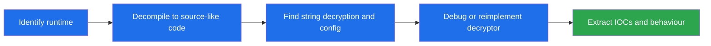

# Reversing Bytecode Malware (.NET, Visual Basic, Java, Python)

## Summary

Not all malware is native x86/x64 machine code. A lot of it is written in languages that compile to an intermediate **bytecode** that a runtime (the .NET CLR, the Java Virtual Machine, the CPython interpreter) executes or compiles at run time. Bytecode keeps far more information than native code: type names, method names, and a regular instruction set. That makes it much easier to decompile back to near-source, which is why malware authors lean on **obfuscators** that rename symbols, encrypt strings and scramble control flow (T1027). The analyst's job is to identify the runtime, pick the right decompiler, and then undo the obfuscation (T1140).

## Platform by platform

| Platform | How to recognise it | What the bytecode is | Typical tooling |
|---|---|---|---|
| **.NET** | A PE file whose code is Common Intermediate Language (CIL) with an assembly manifest and metadata | CIL, a stack-based instruction set | dnSpy (decompile, edit and debug .NET assemblies without source), ILSpy |
| **Java** | `.class` files (often inside `.jar` archives); every class file starts with the magic value `0xCAFEBABE` | JVM bytecode, also stack-based | Java decompilers; the class file format is defined in the JVM specification, chapter 4 |
| **Python** | `.pyc` files (compiled by `py_compile`, usually under `__pycache__`), or Python bundled into an executable | CPython bytecode | The standard `dis` module disassembles it; third-party decompilers vary by Python version |
| **Visual Basic 6** | VB runtime imports in a PE file | Either native code or VB "p-code" (unverified, see open issues) | Specialised VB decompilers |

## Working method

1. **Identify the runtime**: file type, imports and headers tell you whether you are looking at native code or bytecode.
2. **Decompile**: for .NET and Java the output is often close to the original source.
3. **De-obfuscate**: rename meaningless symbols as you understand them; find the string-decryption routine and run or reimplement it to recover strings and configuration.
4. **Debug when needed**: dnSpy can set breakpoints and step through .NET code, and can save variables such as decrypted byte arrays to disk, which is often faster than reimplementing a decryptor.
5. **Patch if useful**: .NET assemblies can be edited and saved, for example to disable an anti-analysis check.

## Python caveat

Python's documentation is explicit that bytecode is an implementation detail of CPython and that instructions can be added, removed or changed between versions. A decompiler that works on one Python version's `.pyc` files may fail on another, so first establish which version produced the sample.

## Security relevance

- Commodity stealers and RATs are frequently .NET, so .NET skills pay off quickly in a SOC.
- Obfuscators are common in legitimate software too, so obfuscation alone is not proof of malice.
- Bytecode samples can still drop or load native code; follow the execution into those stages.

## ATT&CK mapping

- **T1027 Obfuscated Files or Information**: renamed symbols, encrypted strings, packed resources.
- **T1140 Deobfuscate/Decode Files or Information**: the run-time decryption the analyst reproduces.
- **T1059.006 Python**: Python-based malware execution.

## Explanation

Native code is a cake: you can taste it and guess the recipe. Bytecode is a cake that still has the recipe card taped to the bottom, so obfuscators scribble over the card. Your job is mostly to wipe off the scribbles.
