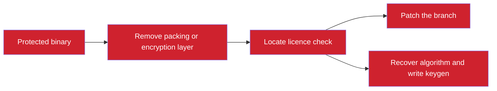

# Software Piracy, Copy Protection and Cracking

## Summary

Copy protection tries to stop software from being used without a licence; digital rights management (DRM) tries to control how media is copied or played. Both run into the same problem: the protected program, and the code that checks the licence, run on a machine the attacker controls. A reverse engineer can find the check and change it. This topic matters to defenders for a second reason: the **anti-reversing tricks** that protection vendors invented (packing, code encryption, debugger detection) are exactly the tricks malware authors now use to slow analysts down.

## Common protection schemes

| Scheme | Idea | Typical weakness |
|---|---|---|
| **Serial number / licence key** | Program validates a key with a local algorithm | The algorithm is in the binary, so it can be patched or reimplemented (a "keygen") |
| **Challenge-response / online activation** | A server signs a response tied to the machine | Strong while the server check stays in the loop; weak if the client can be patched to skip it |
| **Hardware token (dongle)** | Program queries a physical device | The query and the decision still happen in software |
| **Media-based** | Checks for a feature of the original disc | Disappears with digital distribution |
| **Server-side logic (SaaS)** | The valuable code never ships to the user | Hardest to crack, because there is nothing local to patch |
| **Watermarking** | Marks each copy so leaks can be traced | Deters rather than prevents |

A central lesson is the **class break**: once one copy is cracked, the crack usually works for every copy. Protection raises the cost of an attack; it does not make it impossible.

## How cracking works (conceptually)

1. Find the decision point, for example the branch after the licence check, by tracing from the error message or the key-entry dialog.
2. Either patch the decision (force the "valid" path) or understand the algorithm well enough to generate valid keys.
3. Defeat any anti-reversing layers that hide the code first.

## Anti-reversing techniques you will meet again in malware

- **Debugger checks**: `IsDebuggerPresent` reports whether the calling process runs under a user-mode debugger; `CheckRemoteDebuggerPresent` asks the same about another process (where "remote" means a separate process, not a separate computer). ATT&CK tracks this as T1622 Debugger Evasion.
- **Packing and code encryption**: the real code is decrypted only at run time (T1027.002 Software Packing).
- **Symbol stripping and obfuscation**: removes names and structure that would make static analysis easy.
- **Self-checksums**: the program checks its own code bytes, which also catches software breakpoints inserted by a debugger.

## Defender takeaways

- Treat client-side protection as a speed bump. Put critical logic or entitlement checks on a server.
- Analysts should recognise these anti-reversing patterns on sight, because malware reuses them.
- Cracked software is a common malware delivery vehicle: the "crack" or "keygen" itself is often the payload.

## ATT&CK mapping

- **T1622 Debugger Evasion**: debugger-detection checks.
- **T1027.002 Software Packing**: packers and protectors that hide the real code.

## Explanation

Copy protection is like a bouncer who works inside your own house. You can't fire him, but you can watch where he stands, see which list he checks, and swap the list. Moving the bouncer to a club across town (server-side checks) is the only way to stop the swap.
