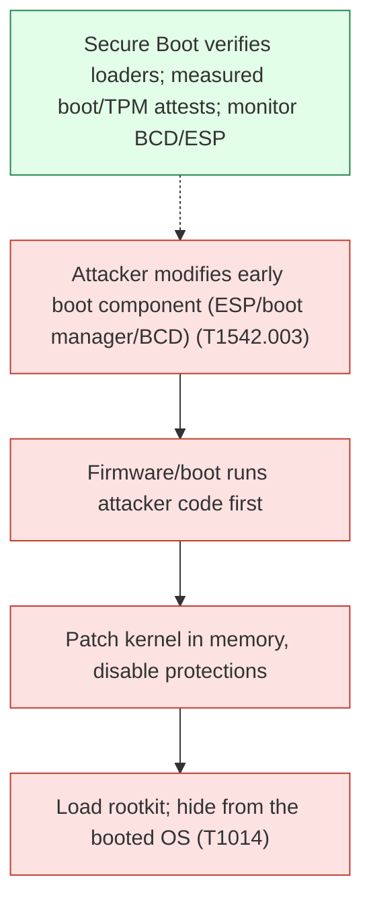

# Bootkits

## Summary

A bootkit is a rootkit that compromises the boot chain so that attacker code runs **before** the Windows kernel and its security tools load (pre-OS boot: bootkit, T1542.003). By subverting an early boot component — historically the MBR/VBR on BIOS systems, and the EFI boot manager/loader or the EFI System Partition on UEFI systems — a bootkit gains control first and can then patch the kernel in memory, disable protections, and hide its presence (rootkit, T1014). Running before the OS is what makes bootkits so powerful and so stealthy: the very software meant to detect them hasn't started yet. Secure Boot and measured boot exist specifically to close this window, which is why bootkits increasingly target gaps in or around Secure Boot.

## How bootkits persist and hide

| Target | Mechanism |
|---|---|
| **EFI boot manager/loader** | Replace or patch `bootmgfw.efi`/`winload.efi` or their load path |
| **EFI System Partition (ESP)** | Plant a malicious bootloader the firmware launches |
| **Boot configuration (BCD)** | Alter boot settings to load attacker components |
| **In-memory kernel patch** | Once running early, disable integrity checks and insert the rootkit |

The advantage is sequencing: whoever executes first controls what the next stage sees, so a bootkit can neutralise defences before they initialise and then make itself invisible to the booted OS.

## Boot-chain compromise

## Detection

- Secure Boot disabled or boot components with invalid/unexpected signatures.
- Changes to the EFI System Partition, boot manager/loader files, or BCD entries.
- Measured-boot / TPM attestation mismatches against known-good boot measurements.
- ELAM or early-launch telemetry indicating tampering, and offline forensic inspection of the ESP.

## Defense

- **Enable Secure Boot** so firmware refuses unsigned/altered boot components.
- **Measured boot with TPM + remote attestation** to detect pre-OS tampering even if execution isn't blocked.
- **Monitor the ESP, boot files, and BCD** for modification; protect them with least privilege.
- **Keep firmware updated** and apply Secure Boot revocations (e.g. DBX updates) for known-bad loaders.
- **Response**: rebuild boot components / reimage; verify firmware integrity.

## ATT&CK mapping

| ID | Name | Tactic |
|---|---|---|
| T1542.003 | Pre-OS Boot: Bootkit | Persistence, Stealth |
| T1014 | Rootkit | Stealth |

## Explanation

Every security tool on a computer is a guard who starts their shift only after the building opens. A bootkit is an intruder who slips in during the night, before opening, and rigs the alarm panel and the guard roster. When the guards finally clock in, they're already working off tampered instructions and can't see the intruder at all, because the intruder arranged things while no one was watching. That early-bird advantage is the whole point. The answer is to check the building's integrity *before* letting it open: Secure Boot refuses to start if the locks were changed, and measured boot keeps a sealed, tamper-evident record of exactly what ran during the night — so even a clever overnight visitor leaves a trace someone can verify in the morning.
