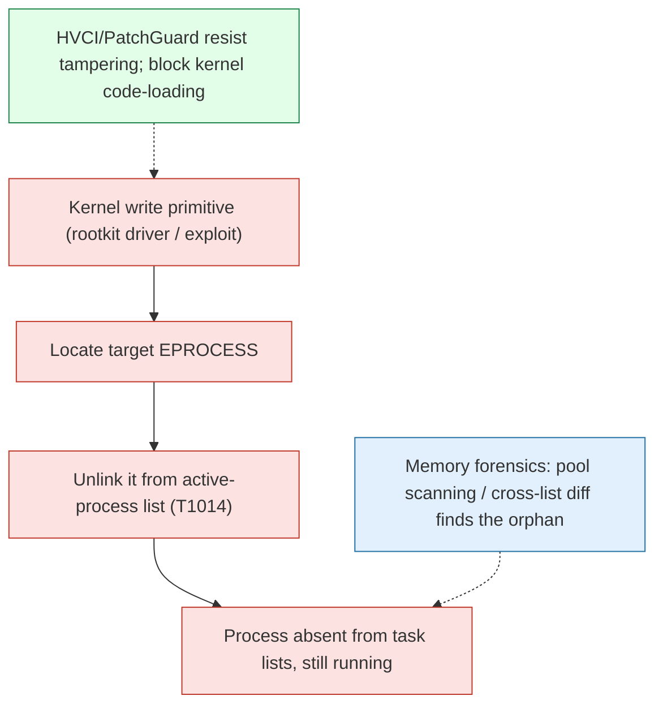

# Direct Kernel Object Manipulation (DKOM)

## Summary

Direct Kernel Object Manipulation is a kernel-rootkit technique that hides or alters things by editing the kernel's in-memory objects directly, rather than hooking functions. The classic example hides a process by unlinking its `EPROCESS` structure from the doubly-linked list the OS walks to enumerate running processes: the process keeps running (the scheduler uses a different structure) but no longer appears in any process list (rootkit, T1014). DKOM can similarly hide drivers, elevate a process's token, or alter object fields. Because it changes data the OS treats as ground truth, DKOM defeats tools that ask the OS politely — but it leaves the manipulated structures inconsistent, which is exactly what memory forensics exploits to find the hidden objects.

## How DKOM works

| Target | Manipulation | Result |
|---|---|---|
| **Process list** | Unlink `EPROCESS` from the active-process linked list | Process hidden from enumeration, still scheduled |
| **Driver list** | Unlink the driver/module object | Driver hidden from module lists |
| **Token** | Overwrite a process's token/privileges fields | Privilege escalation via data edit |
| **Object fields** | Alter flags/counts | Various stealth or integrity effects |

The subtlety: the OS keeps several views of the same thing (a process is on the enumeration list *and* reachable via the scheduler and handle tables), so unlinking it from one view leaves the others pointing at a "nonexistent" object — a detectable inconsistency.

## DKOM flow

## Detection

- **Pool-tag scanning**: find `EPROCESS`/object structures in kernel pool memory that are not present in the official linked lists (the hallmark of DKOM hiding).
- **Cross-list correlation**: compare processes seen via scheduler/handle tables/CSRSS against the active-process list.
- Memory-forensics tools (e.g. Volatility-style `psscan` vs `pslist`) that reveal unlinked objects.
- Integrity-protection events if the write to kernel structures is blocked/flagged.

## Defense

- **Prevent kernel writes**: HVCI, PatchGuard, driver signing, vulnerable-driver blocklist, least privilege — DKOM needs a kernel write primitive.
- **Memory forensics in hunting/IR**: scan for orphaned objects rather than trusting live enumeration.
- **Measured boot / ELAM** to reduce the chance a rootkit loads at all.
- **Response**: treat confirmed DKOM as a kernel compromise (reimage; check firmware).

## ATT&CK mapping

| ID | Name | Tactic |
|---|---|---|
| T1014 | Rootkit | Stealth |

## Explanation

DKOM is the trick of making someone vanish from the guest list without actually removing them from the party. Windows keeps a chain of index cards, one per running program, and to list processes it simply walks the chain. A DKOM rootkit reaches into memory and splices one card out of the chain — before-card now points straight to after-card — so the program is skipped by every roll call, even though it is still very much in the room, dancing, because the band (the scheduler) tracks dancers a different way. The flaw in the illusion is that the party keeps other records too, and a vanished guest who is plainly still dancing but is on no one's list is a glaring contradiction. Memory forensics hunts for exactly that contradiction: an index card floating in memory that belongs to no chain.
