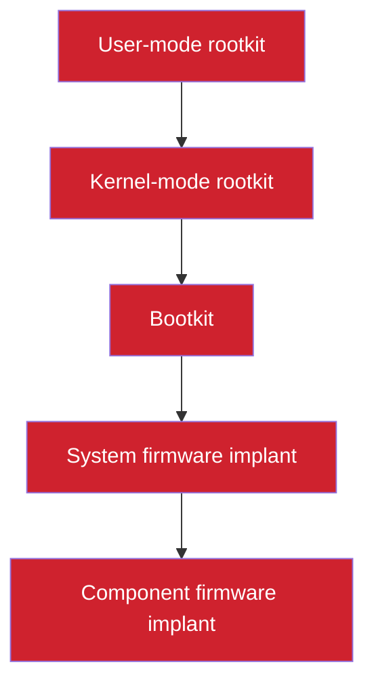

# Hardware and Firmware Rootkit Techniques (Keyboard Controller, Microcode)

## Summary

Every software rootkit has the same weakness: it lives somewhere the defender's software can eventually look, on disk or in OS memory, and it is gone after a reinstall. Moving the rootkit **into firmware or hardware** removes both weaknesses. Code in system firmware (T1542.001) or in the firmware of a component such as a disk controller or network card (T1542.002) runs outside the operating system, survives reinstallation and disk re-imaging, and is invisible to tools that only inspect the OS. *Rootkits: Subverting the Windows Kernel* (2005) introduced these ideas to a Windows audience; later UEFI implants applied them at scale.

## Techniques

| Technique | Idea | Status of evidence |
|---|---|---|
| **System firmware modification** | Patch BIOS/UEFI so malicious code runs before the OS and can tamper with it as it loads | Real-world UEFI implants exist; see [UEFI Rootkits and Firmware Implants](uefi-rootkits-and-firmware-implants.md) |
| **Component firmware** | Malicious firmware in a peripheral or controller; ATT&CK notes it can persist across re-images and evade host software defences | Documented by ATT&CK (T1542.002) |
| **Direct hardware access** | Talk to a device's controller directly instead of through its driver stack, e.g. reading keystrokes from the keyboard controller so driver-level monitoring never sees the request (T1056.001 Keylogging) | Book example; unverified on current hardware |
| **CPU microcode** | Used in the book as a thought experiment on how far down malicious code could theoretically sit | Book discussion; unverified |

Each step down the stack is harder to build and harder to detect, and survives more kinds of clean-up.

## Why defenders care

- **Reinstalling doesn't clean it.** A firmware implant survives an OS reinstall; component firmware can survive a disk replacement.
- **OS-based tools are blind.** EDR and antivirus run on top of the compromised layer.
- **Detection needs a lower vantage point**: firmware image acquisition and comparison, platform configuration checks, or hardware-rooted measurement.

## Defences

- Keep system and device firmware updated from the vendor; enable firmware write protections and Secure Boot.
- Audit platform firmware protections with CHIPSEC (see [UEFI Firmware Vulnerabilities](../exploitation/uefi-firmware-vulnerabilities.md)).
- Acquire and compare firmware images during investigations of high-value systems (see [BIOS/UEFI Firmware Forensics](../forensics/bios-uefi-firmware-forensics.md)).
- For high-assurance cases, treat hardware replacement as a possible remediation step.

## ATT&CK mapping

- **T1542.001 System Firmware**, **T1542.002 Component Firmware**: persistence below the OS.
- **T1056.001 Keylogging**: the keyboard-controller example.
- **T1014 Rootkit**

## Explanation

A software rootkit hides in the furniture; a reinstall throws the furniture out. A firmware rootkit hides in the wiring of the house. You can repaint and refurnish forever, and the wiring still carries the intruder's signal.
