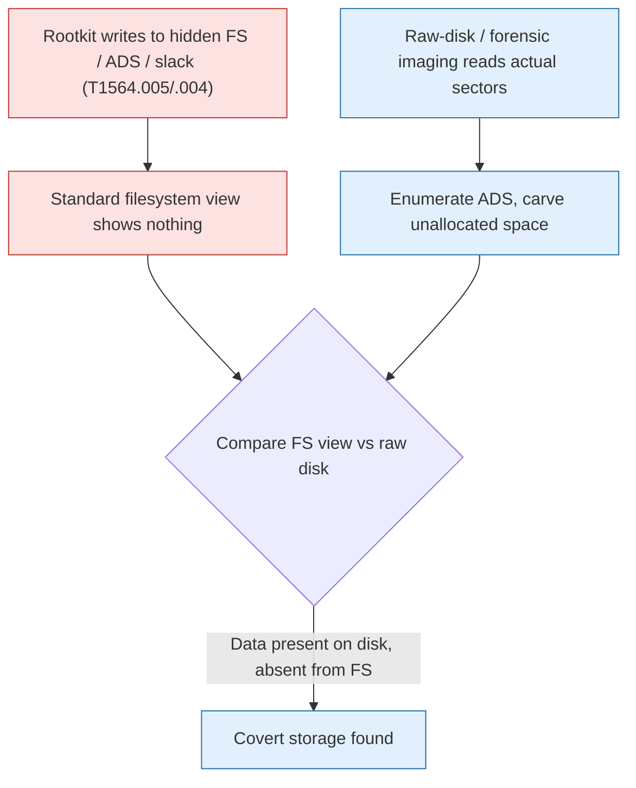

# Hidden File Systems and Covert Storage

## Summary

Sophisticated rootkits need somewhere to keep their own files — payloads, configuration, stolen data — that an administrator or forensic tool will not find. Rather than hiding individual files, the most advanced implants create an entire **hidden file system**: a private, often encrypted container stored in unallocated disk space, in a dedicated partition, or inside a single opaque file, accessed only through the rootkit's own driver (hide artifacts: hidden file system, T1564.005). A lighter-weight relative is **NTFS Alternate Data Streams**, which tuck data into a stream attached to an ordinary file so it does not appear in normal listings (hide artifacts: NTFS file attributes, T1564.004). Both exploit the gap between what the standard filesystem view shows and what the raw disk actually holds — which is also how forensics finds them.

## Covert storage techniques

| Technique | Where data lives | Normal view |
|---|---|---|
| **Hidden file system (T1564.005)** | Unallocated space / hidden partition / opaque container, via rootkit driver | Invisible to the OS filesystem |
| **Alternate Data Streams (T1564.004)** | A named stream on an existing NTFS file | Hidden from default listings |
| **Slack space / steganography** | Unused areas or inside other files | Not shown as files at all |

The common principle: store data outside the structures the OS enumerates, so routine inspection sees nothing, while the rootkit reaches it through a private path.

## Covert storage vs forensic view

## Detection

- **Alternate Data Stream enumeration** (e.g. directory listing that shows streams) to find data hidden on ordinary files.
- **Raw-disk forensics**: image the disk and carve unallocated space / unexplained partitions for hidden containers.
- **Disk-space accounting discrepancies** (space used that the filesystem cannot account for).
- The presence of a rootkit driver that mediates access to a region the OS doesn't map.

## Defense

- **Forensic imaging and raw-disk analysis** in IR rather than trusting the live filesystem.
- **ADS-aware scanning** and tooling that enumerates streams.
- **Block kernel rootkits** (HVCI, driver controls) so a hidden-FS driver cannot be installed.
- **Application control and EDR** to catch the implant before it provisions covert storage.
- **Baseline disk layout/partitioning** and alert on unexplained changes.

## ATT&CK mapping

| ID | Name | Tactic |
|---|---|---|
| T1564.005 | Hide Artifacts: Hidden File System | Stealth |
| T1564.004 | Hide Artifacts: NTFS File Attributes | Stealth |
| T1014 | Rootkit | Stealth |

## Explanation

A hidden file system is a secret room behind the bookcase. The house's floor plan (the normal filesystem) shows no such room, so a visitor counting doors never finds it, yet the owner slips in and out through a catch only they know about (the rootkit's driver). Alternate Data Streams are a gentler version of the same idea: a secret note taped to the back of a book already on the shelf — the book is in the catalogue, the note is not. The way to find either is to stop trusting the floor plan and measure the house itself: tap the walls, weigh the building, read the actual bricks (image the raw disk). When the physical space holds more than the plan admits to, you've found the hidden room — and that space-versus-plan discrepancy is exactly what forensic analysis looks for.
