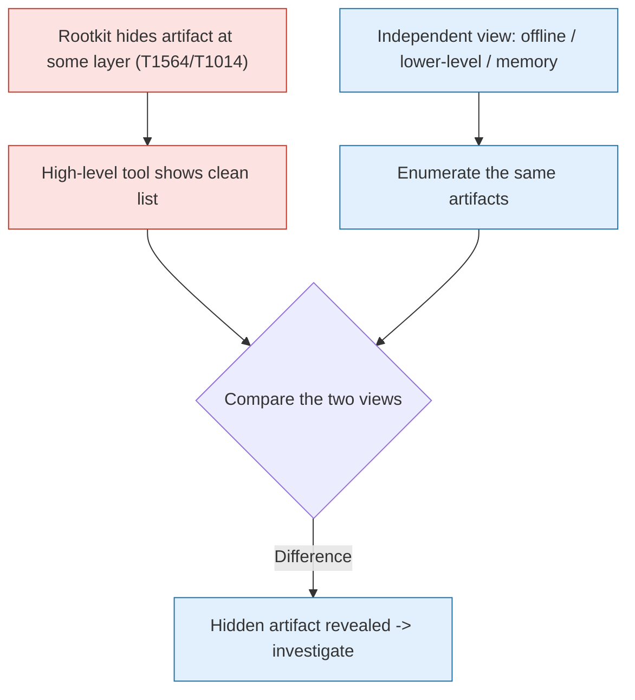

# Hidden Processes and Artifacts

## Summary

Hiding artifacts is the practical goal most rootkits serve: make processes, files, directories, registry keys, services, or network connections invisible to the tools an administrator uses (hide artifacts, T1564; rootkit, T1014). The means range from simple (set a file's hidden attribute, name things to blend in) to deep (kernel manipulation that unlinks a process so it never appears in any list). The level of hiding determines the detection method: attribute tricks fall to a thorough file listing, while kernel-level hiding requires memory forensics or cross-view comparison. This file ties together the hiding techniques and the single most reliable detection idea against all of them — compare two independent views and investigate the difference.

## Spectrum of hiding

| Technique | Example | Detection |
|---|---|---|
| **Attributes/naming** | Hidden/system attributes (T1564.001), look-alike names | Full/attribute-agnostic enumeration |
| **API filtering (user-mode)** | Hook enumeration APIs to drop entries | Lower-level or offline query |
| **Kernel object edits (DKOM)** | Unlink process/driver from OS lists | Pool scanning / cross-list diff |
| **Alternate storage** | ADS, hidden file systems | ADS enumeration; raw disk/forensics |

Whatever the depth, hiding works by making one authoritative view lie; detection works by holding that view against a second, independently-derived one.

## Hiding vs cross-view detection

## Detection

- **Cross-view comparison** of processes (pslist vs psscan), files (API listing vs raw disk), registry, and services.
- **Memory forensics** to find unlinked/hidden kernel objects.
- **Alternate Data Stream enumeration** and raw-disk inspection for hidden storage.
- **Network cross-check**: connections seen on the host vs seen at the network boundary (a host hiding a beacon still generates traffic the network sees).

## Defense

- **Behavioural EDR and memory scanning** rather than trusting live-OS enumeration alone.
- **Block kernel rootkits** (HVCI, driver controls) so deep hiding can't be installed.
- **Network-side visibility** so host-level hiding doesn't hide the traffic.
- **Baseline and hunt**: compare current state against known-good inventories.
- **Response**: deep hiding implies a serious compromise — escalate to forensic IR.

## ATT&CK mapping

| ID | Name | Tactic |
|---|---|---|
| T1564 | Hide Artifacts | Stealth |
| T1564.001 | Hide Artifacts: Hidden Files and Directories | Stealth |
| T1014 | Rootkit | Stealth |

## Explanation

All hiding, from the crudest to the most advanced, is one move: control the single source of truth someone will consult, and edit it before they read it. Mark a file "hidden" and the casual listing skips it; hook the listing function and even a careful listing lies; rewrite the kernel's records and every listing lies. The counter is always the same and wonderfully robust: don't rely on one source of truth. Ask the same question two different ways — once through the system and once around it, by reading memory, raw disk, or the network directly — and whatever appears in one view but not the other is precisely the thing someone went to the trouble of hiding. A hidden program that still phones home, in particular, gives itself away the moment you watch the wire instead of the host.
