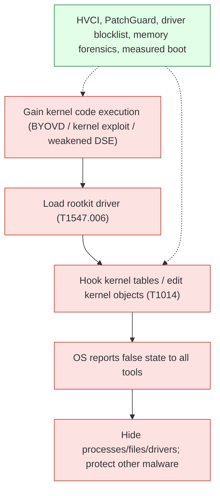

# Kernel-Mode Rootkits

## Summary

A kernel-mode rootkit runs as a driver, with the same full privilege as the operating system itself. From there it can manipulate the kernel's own data structures and callback mechanisms so that the OS reports a false picture of reality to every tool above it — hiding processes, files, drivers, and network activity system-wide (rootkit, T1014), and persisting as a kernel module (boot or logon autostart execution: kernel modules and extensions, T1547.006). Because the lie is told by the kernel, user-mode defences that trust the kernel are blinded. The catch for attackers is the entry cost: installing kernel code requires defeating Driver Signature Enforcement, which today usually means BYOVD (a signed vulnerable driver) or a kernel exploit. This is why controlling kernel code-loading is the decisive defence.

## Techniques

| Technique | Effect |
|---|---|
| **Kernel hooking** | Patch system-service or callback tables so the rootkit intercepts OS operations |
| **DKOM** | Directly edit kernel objects (e.g. unlink a process from the active list) — see its own file |
| **Callback/filter abuse** | Register or subvert kernel callbacks and filter drivers to intercept I/O |
| **Driver persistence (T1547.006)** | Install as a (boot-start) driver so it loads early and reliably |

Operating in the kernel means the rootkit can lie to the Security Reference Monitor, the object manager, and the I/O path — the very machinery tools depend on — so detection must often come from outside the running OS.

## Install and operate

## Detection

- **Memory forensics**: scan kernel memory directly (pool scanning, structure walking) to find hidden objects the OS denies.
- **Driver anomalies**: unsigned/unexpected drivers, unusual kernel callbacks, and hooks in system-service/callback tables.
- **PatchGuard/HVCI integrity events** and BYOVD indicators (known-vulnerable driver loads, EDR tampering).
- Discrepancies between live-OS enumeration and offline/forensic views.

## Defense

- **Block kernel code-loading**: HVCI (memory integrity), WDAC driver policies, the Microsoft vulnerable-driver blocklist, and Driver Signature Enforcement.
- **Kernel Patch Protection (PatchGuard)** on 64-bit Windows resists patching of key kernel structures.
- **Measured/secure boot and ELAM** to vet early drivers.
- **Memory-based and offline detection** rather than trusting the live kernel.
- **Response**: a confirmed kernel rootkit generally means reimaging; verify firmware too.

## ATT&CK mapping

| ID | Name | Tactic |
|---|---|---|
| T1014 | Rootkit | Stealth |
| T1547.006 | Boot or Logon Autostart Execution: Kernel Modules and Extensions | Persistence, Privilege Escalation |

## Explanation

If a user-mode rootkit is a crooked receptionist, a kernel-mode rootkit is the head of records who writes the master ledger everyone else copies from. When the kernel itself is compromised, there is no "real register behind the desk" to check — the authoritative source is the liar. That is what makes these rootkits so powerful and so feared. The saving grace for defenders is the price of admission: putting code in the kernel means getting past the bouncer who only admits signed drivers, so modern defence concentrates there (block the known-pickable signed drivers, enforce memory integrity) and, when a rootkit is suspected, stops interrogating the compromised system and instead reads its memory and boot measurements from the outside.
