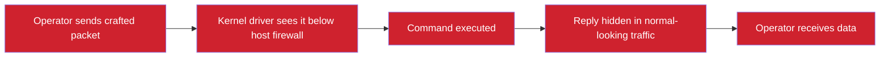

# Rootkit Covert Channels and Network Command and Control

## Summary

Hiding files and processes is only half a rootkit's job. It also needs to **talk**: receive commands and send out stolen data. A normal user-mode socket shows up in `netstat`, host firewalls and EDR network telemetry. A kernel rootkit can instead send and receive packets from inside the network stack, below the points where host tools look, and can shape its traffic to look like something harmless. *Rootkits: Subverting the Windows Kernel* (2005) built such channels on the Windows network driver interfaces of the time; the design ideas still apply, though the interfaces have changed.

## Where a kernel channel can sit

| Interface | What it is (per Microsoft's driver docs) | Rootkit use |
|---|---|---|
| **TDI** (Transport Driver Interface) | The legacy kernel interface to transports; Microsoft states TDI will not be supported in Windows versions after Vista and points to WFP or Winsock Kernel instead | The 2005-era way to open connections from the kernel |
| **NDIS filter drivers** | Drivers that sit between protocol and miniport drivers in the NDIS stack and filter traffic | See and inject raw packets below the host firewall and many sniffers |
| **WFP callout drivers** | Kernel drivers that plug into the Windows Filtering Platform to inspect and modify traffic | The modern place to inspect or alter traffic in the kernel; also used by security products |
| **Winsock Kernel (WSK)** | Kernel-mode sockets interface | Kernel-originated connections |

## Channel designs

- **Protocol camouflage**: hide commands inside fields or protocols that look normal, e.g. inside otherwise ordinary DNS, HTTP or ICMP (T1001 Data Obfuscation, T1095 Non-Application Layer Protocol).
- **Traffic signalling**: stay silent until a specially crafted "magic" packet arrives, then act (T1205 Traffic Signaling). Nothing is listening in the usual sense, so port scans show nothing.
- **Raw packet handling and host emulation**: build packets directly so traffic appears to come from another host or service, bypassing the local TCP/IP stack's bookkeeping.
- **Exfiltration over the same channel** (T1041).

## Detection

- **Look from outside the host.** Network sensors, firewalls and flow logs don't depend on the compromised kernel. Compare what the network saw with what the host reports.
- **Inventory network drivers**: unexpected NDIS filter or WFP callout drivers, especially unsigned or recently installed ones.
- **Memory forensics** shows network objects and drivers independently of the live OS (see [Network Artifacts in Memory](../forensics/network-artifacts-in-memory.md)).
- **Protocol anomaly detection**: odd ICMP payloads, DNS queries with high-entropy labels, traffic with no matching host connection.

## ATT&CK mapping

- **T1095 Non-Application Layer Protocol**, **T1205 Traffic Signaling**, **T1001 Data Obfuscation**: covert channel designs.
- **T1041 Exfiltration Over C2 Channel**
- **T1014 Rootkit**

## Explanation

A normal program that phones home uses the office switchboard, where every call is logged. A kernel rootkit taps directly into the phone line in the wall, below the switchboard, and speaks in a code that sounds like line noise. To catch it you listen on the street (the network), not at the switchboard.
