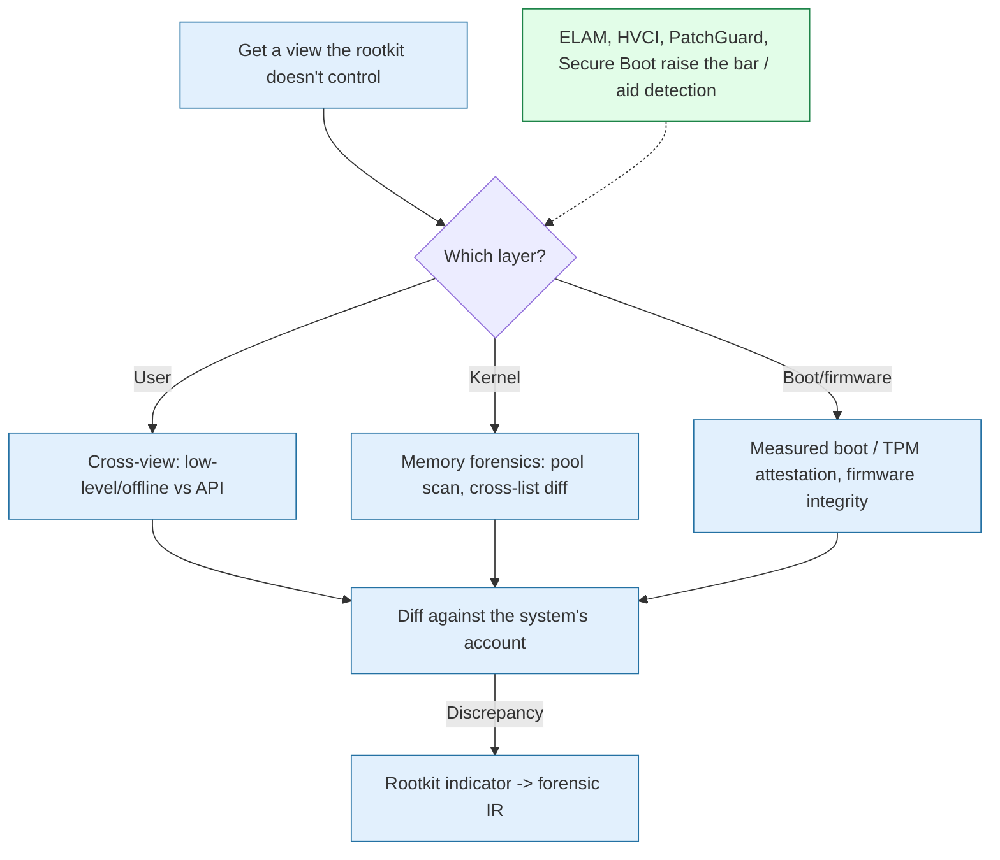

# Rootkit Detection (Memory Forensics, Cross-View, ELAM)

## Summary

Detecting a rootkit means answering its central lie: it controls what the system reports, so you cannot simply ask the system (rootkit, T1014). Reliable detection comes from obtaining a view the rootkit does not control and comparing it to the system's own account. The main approaches are **cross-view comparison** (query high-level vs low-level/offline and diff), **memory forensics** (read kernel structures directly, e.g. pool-tag scanning for objects the OS hides), **early-launch defences** (ELAM vets boot drivers before most code runs; Secure/measured boot covers below-OS implants), and **integrity protections** (HVCI, PatchGuard) that make kernel tampering harder in the first place. This file consolidates detection strategy across all rootkit depths; the hiding techniques themselves are in their own files.

## Detection strategies by depth

| Depth | Best detection |
|---|---|
| **User-mode** | Cross-view (query below the hook), hook/injection detection |
| **Kernel-mode / DKOM** | Memory forensics: pool-tag scanning, cross-list diff of kernel objects |
| **Boot** | Measured boot / TPM attestation; offline inspection of ESP/boot files |
| **Firmware** | Firmware-integrity tooling and platform attestation |

The unifying idea — **don't trust the compromised layer** — is why forensic and out-of-band methods beat live-OS tools against a capable rootkit.

## Detection approach

## Detection (indicators)

- **Cross-view discrepancies**: processes, files, registry keys, services, or connections present in one view but hidden in another.
- **Memory-forensic finds**: kernel objects (e.g. `EPROCESS`) in pool memory not on the official lists; hooked service/callback tables.
- **Boot/firmware**: measured-boot attestation mismatches, Secure Boot disabled, modified ESP/firmware.
- **Tamper signals**: security products disabled, vulnerable-driver loads (BYOVD), PatchGuard/HVCI integrity events.

## Defense

- **ELAM** so antimalware vets boot-start drivers before other third-party code runs.
- **Secure Boot + measured boot/TPM attestation** to block and detect below-OS implants.
- **HVCI and PatchGuard** to resist kernel tampering; **driver controls** (signing, blocklist) to stop kernel rootkits loading.
- **Memory forensics and offline/cross-view scanning** in hunting and IR.
- **Response posture**: a confirmed kernel/boot/firmware rootkit generally means reimage, and for firmware a reflash or hardware replacement.

## ATT&CK mapping

| ID | Name | Tactic |
|---|---|---|
| T1014 | Rootkit | Stealth |

(This file is detection/mitigation-focused; T1014 is the technique being detected.)

## Explanation

You cannot catch a liar by asking them whether they are lying. Every rootkit detection method is a way of getting a second, independent account that the liar never touched, then holding it up against the story the system tells. For a shallow rootkit, that second account is just a lower-level query. For a kernel rootkit, it's reading the machine's memory directly and noticing a program that's plainly running but appears on no official list. For a bootkit or firmware implant, it's a tamper-evident record made before the liar woke up (measured boot) or a direct read of the chips. Meanwhile defences like ELAM, HVCI, PatchGuard and Secure Boot work the other end, making it harder for the liar to get into position at all. The practical rule is simple and worth repeating: when you suspect a rootkit, stop interrogating the suspect and go find the evidence it couldn't reach.
