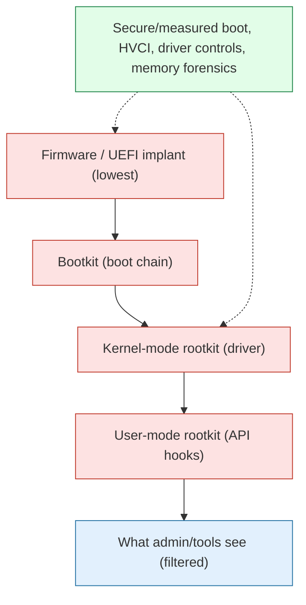

# Rootkits Overview (User-Mode vs Kernel-Mode)

## Summary

A rootkit is malware whose defining goal is **stealth**: hiding its own presence (and often other malware) from users, administrators, and security tools, usually to maintain long-term access (rootkit, T1014). Rootkits differ by the privilege level they operate at, which determines both their power and how hard they are to detect. **User-mode rootkits** hook or tamper with API calls inside processes to filter what tools see; they are easier to build and to catch. **Kernel-mode rootkits** run as drivers with full system privilege and can alter the operating system's own bookkeeping, hiding far more convincingly — but require kernel access to install. The deepest implants move below the OS entirely, into the boot chain or firmware (covered in their own files). Knowing the levels frames both the threat and the layered defences.

## The levels

| Level | How it hides | Detectability |
|---|---|---|
| **User-mode** | Hook API functions in a process to filter results (files, processes, registry) | Easier — compare against lower-level truth |
| **Kernel-mode** | Driver manipulates kernel structures/callbacks; can hide system-wide | Hard — the OS itself is lying |
| **Boot/firmware** | Loads before the OS (bootkit) or in firmware (UEFI implant) | Hardest — runs before defences |

The core trick at every level is the same: sit between the observer and the truth, and edit what the observer is allowed to see. The lower the rootkit sits, the more of the stack it can lie to.

## Where rootkits sit

## Detection

- **Cross-view comparison**: list resources via a high-level API and via a lower-level/offline method; discrepancies reveal hiding.
- **Memory forensics** (e.g. scanning kernel structures directly) to find objects the OS is hiding.
- **Measured/secure boot and firmware integrity** to catch below-OS implants.
- Unexpected drivers, kernel callbacks/hooks, and tamper with security products.

## Defense

- **Prevent kernel access**: driver signing, HVCI, vulnerable-driver blocklist, least privilege.
- **Secure Boot + measured boot** to block and detect boot/firmware rootkits.
- **ELAM and protected processes** to vet early drivers and shield security tooling.
- **Offline and memory-based detection** rather than trusting a possibly-compromised live OS.
- **Assume-breach response**: deep rootkits often warrant reimaging/firmware reflash.

## ATT&CK mapping

| ID | Name | Tactic |
|---|---|---|
| T1014 | Rootkit | Stealth |

## Explanation

A rootkit's whole job is to be the thing you can't see. Imagine asking the building manager for a list of everyone inside, not realising the manager is working for the intruder and simply crosses certain names off before handing you the list. A user-mode rootkit is a junior clerk doing that editing at the front desk — annoying, but you can check the real logbook behind them. A kernel-mode rootkit is the manager themselves rewriting the master records, so every list you ask for is already false. And a firmware or bootkit implant is someone who got to the building before it even opened, rigging the records before anyone arrived. The deeper the liar sits, the less you can trust any question you ask the system, which is why serious detection stops asking the system and inspects memory, boot measurements, and firmware directly.
