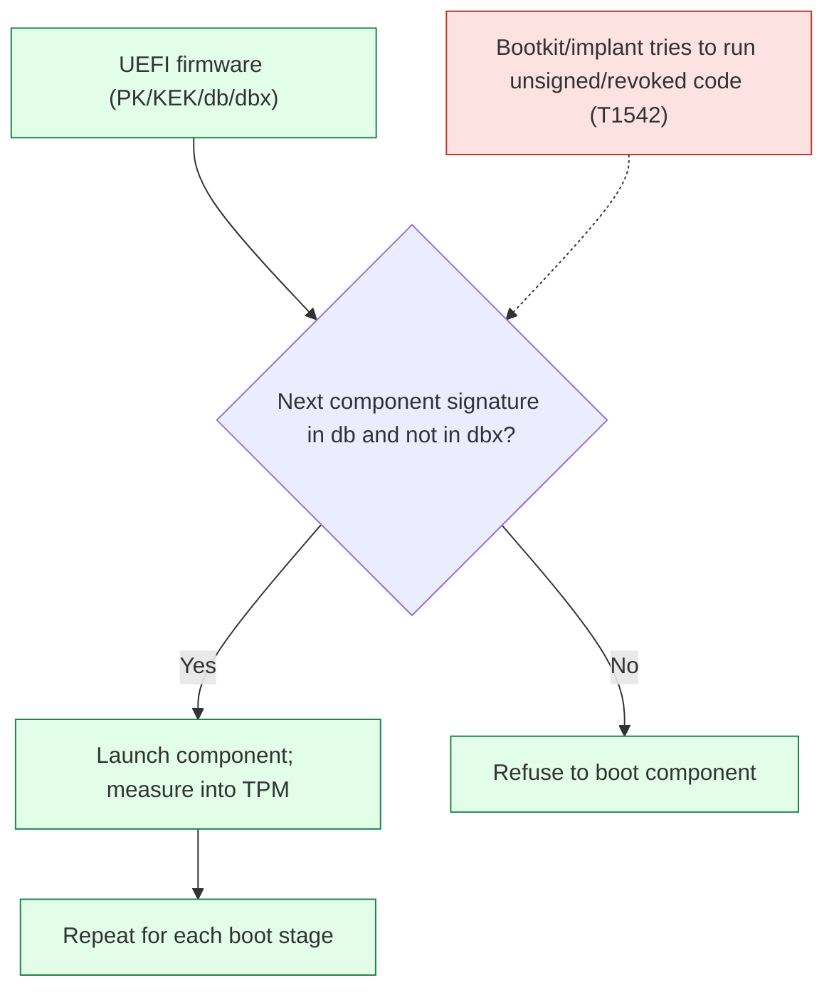

# Secure Boot and UEFI Security

## Summary

Secure Boot is the UEFI feature that makes the firmware verify a digital signature on each boot component before launching it, so only trusted code runs in the pre-OS stage — the defence designed to stop bootkits and firmware implants (which abuse pre-OS boot, T1542.001/T1542.003). It relies on a key hierarchy stored in firmware (the Platform Key, Key Exchange Keys, and the allow/deny databases **db** and **dbx**) and pairs with **measured boot**, which records each stage's hash into the TPM so a verifier can later attest what ran. Together they turn the boot chain from blind trust into verified, tamper-evident trust. Understanding how Secure Boot works — and how attackers target its gaps (misconfiguration, vulnerable signed loaders, unrevoked components) — is essential to defending the lowest layers.

## Key components

| Component | Role |
|---|---|
| **Platform Key (PK)** | Root of trust; controls who can update the key databases |
| **KEK** | Keys authorised to update db/dbx |
| **db (allow) / dbx (deny)** | Signatures/hashes that are permitted / explicitly revoked |
| **Measured boot + TPM** | Records boot-stage measurements for attestation (doesn't block, but detects) |
| **Verified boot (Secure Boot)** | Firmware refuses components failing signature checks |

The dbx (revocation list) matters a lot in practice: when a signed-but-vulnerable bootloader is found, revoking it via dbx is what actually blocks its abuse — so keeping dbx updated is a real defensive task.

## How it protects the boot chain

## Detection

- Secure Boot reported disabled, or in setup/custom mode unexpectedly.
- Out-of-date dbx (missing revocations) that would still allow known-bad loaders.
- Measured-boot/TPM attestation failures against a known-good baseline.
- Unexpected changes to Secure Boot keys/variables or boot order.

## Defense

- **Keep Secure Boot enabled** in standard (not setup) mode on all systems.
- **Apply firmware and dbx (revocation) updates** so vulnerable signed loaders are blocked.
- **Use measured boot with TPM attestation** (and Windows features that consume it) to detect tampering.
- **Protect the key hierarchy and firmware settings** with a firmware password and restricted admin/physical access.
- **Monitor** Secure Boot state and boot measurements as part of health attestation.

## ATT&CK mapping

| ID | Name | Tactic |
|---|---|---|
| T1542.001 | Pre-OS Boot: System Firmware | Persistence, Stealth |
| T1542.003 | Pre-OS Boot: Bootkit | Persistence, Stealth |

(These are the techniques Secure Boot defends against; it is a mitigation, not an attack.)

## Explanation

Secure Boot turns the boot sequence from "trust whoever shows up" into "ID everyone at the door." The firmware holds a guest list of valid signatures (db) and a banned list (dbx), and it refuses to launch any boot component whose signature isn't approved — so a swapped or unsigned bootloader simply doesn't start. Measured boot adds a notary: it stamps a tamper-proof record of exactly who came through, sealed in the TPM, so even components that were allowed can be checked afterward against what *should* have run. The practical lesson for defenders is that the banned list isn't static: when a once-trusted bootloader turns out to have a pickable lock, you have to add it to the banned list (update dbx), or the door will keep letting it in.
