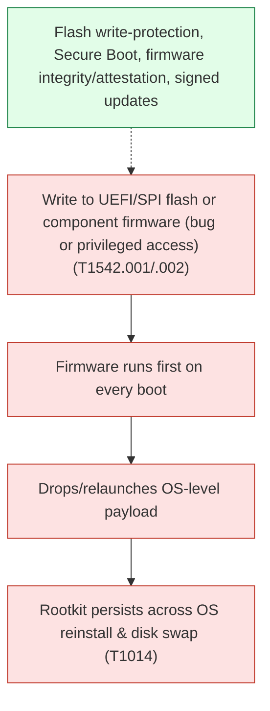

# UEFI Rootkits and Firmware Implants

## Summary

The deepest implants live in firmware — below the operating system, below the bootloader, in the UEFI firmware stored on the motherboard's SPI flash or in the firmware of peripheral components (pre-OS boot: system firmware, T1542.001; component firmware, T1542.002). Because firmware runs first and persists independently of the disk, a UEFI rootkit can survive OS reinstallation and even disk replacement, re-deploying its payload on every boot and hiding from all OS-level tools (rootkit, T1014). These implants are difficult to build and usually require either a firmware vulnerability or privileged/physical access to write flash, but they represent the most resilient persistence known. Defence depends on firmware write-protection, Secure Boot, and firmware-integrity measurement rather than anything the OS can do after the fact.

## Why firmware implants are so resilient

| Property | Consequence |
|---|---|
| **Runs before the OS** | Controls the entire boot, invisible to OS security tools |
| **Stored in SPI flash / device firmware** | Survives OS reinstall and disk swap (T1542.001/.002) |
| **Re-deploys payload each boot** | Reinfects a cleaned OS automatically |
| **Requires flash write** | High bar: firmware bug or privileged/physical access needed |

The combination of "first to run" and "independent of the disk" is what sets firmware implants apart: the usual remediation (wipe and reinstall) simply doesn't reach them.

## Implant lifecycle

## Detection

- Firmware-integrity tooling detecting modified UEFI firmware or unexpected modules/drivers in the firmware volume.
- Secure Boot disabled, or firmware variable/boot-order tampering.
- Reinfection of a freshly reimaged machine (a strong hint of below-OS persistence).
- Vendor firmware-attestation / platform-integrity measurements that fail against known-good baselines.

## Defense

- **Firmware write-protection** (SPI flash protections, BIOS/firmware password, locked-down update path) so flash cannot be casually rewritten.
- **Secure Boot and signed firmware updates**; apply vendor firmware patches promptly.
- **Platform-integrity measurement/attestation** to detect firmware tampering.
- **Supply-chain and physical-access controls** to reduce implant opportunities.
- **Response**: firmware reflash from a trusted image, or hardware replacement, since OS reinstall is insufficient.

## ATT&CK mapping

| ID | Name | Tactic |
|---|---|---|
| T1542.001 | Pre-OS Boot: System Firmware | Persistence, Stealth |
| T1542.002 | Pre-OS Boot: Component Firmware | Persistence, Stealth |
| T1014 | Rootkit | Stealth |

## Explanation

Most malware lives in the house (the operating system) on the disk, so if things get bad enough you bulldoze the house and build a new one — reinstall Windows — and the problem is gone. A firmware implant doesn't live in the house; it lives in the foundations and the plot of land itself (the motherboard's firmware chip). Rebuild the house as many times as you like and the rigged foundations quietly re-install the same trouble every time, and because the foundations are poured before the house exists, no alarm inside the house ever sees it happen. Reaching this layer is hard for attackers — they need a flaw in the concrete or the keys to the site — but once there, they're nearly impossible to evict. That's why the defences are about who's allowed to pour new foundations (flash write-protection, signed updates) and tamper-evident surveys of the ground (firmware attestation), not anything you can do after moving in.
