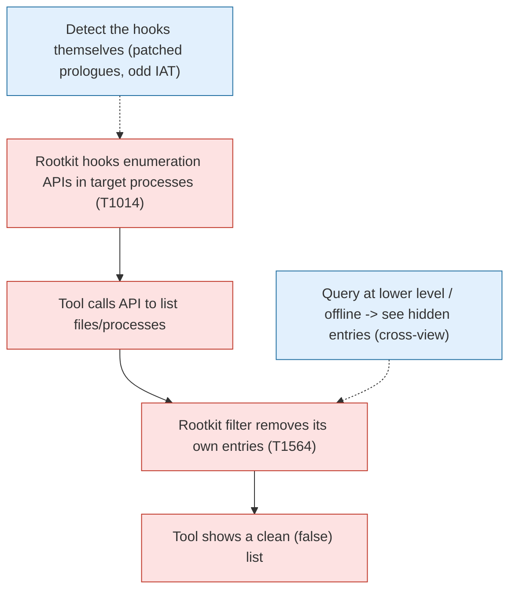

# User-Mode Rootkits

## Summary

A user-mode rootkit hides within ordinary processes rather than the kernel. It achieves stealth by intercepting the API calls that tools use to list files, processes, registry keys, or network connections, and filtering the results so its own artefacts disappear (rootkit, T1014; hide artifacts, T1564). The usual mechanism is hooking — redirecting a function (in the Import Address Table, inline in the function's code, or in a library) so the rootkit's filter runs first. User-mode rootkits are comparatively easy to build and deploy (no kernel access needed) but also comparatively easy to detect, because a tool that queries at a lower level than the hook, or examines the system offline, sees the truth the rootkit tried to edit.

## How they hide

| Technique | Effect |
|---|---|
| **IAT hooking** | Rewrite a process's import table so calls go to the rootkit first |
| **Inline hooking** | Patch the start of an API function to jump to the filter |
| **DLL injection** | Load the rootkit into target processes so its hooks apply there |
| **Result filtering** | Remove its files/processes/keys from enumeration results before returning |

The limitation defines the weakness: a user-mode hook only affects the processes it is injected into and the API layer it patches, so a check performed below that layer — or from a clean process — reveals the hidden items.

## Hiding and detection

## Detection

- **Cross-view comparison**: enumerate via high-level API vs a lower-level or offline method; hidden items show as the difference.
- **Hook detection**: inline-patched function prologues, abnormal IAT entries, and injected modules in unexpected processes.
- Known user-mode rootkit DLLs and injection indicators (remote thread creation, suspicious loaded modules).
- Behavioural EDR flagging the injection and hooking activity itself.

## Defense

- **EDR/AV that inspect below the hooked layer** and detect inline/IAT hooking and injection.
- **Protect sensitive processes (PPL)** so they cannot be injected or hooked.
- **Application control** to stop the rootkit loading in the first place.
- **Cross-view scanning tools** as part of hunting.
- **Least privilege** to limit injection opportunities.

## ATT&CK mapping

| ID | Name | Tactic |
|---|---|---|
| T1014 | Rootkit | Stealth |
| T1564 | Hide Artifacts | Stealth |

## Explanation

A user-mode rootkit is a crooked receptionist. Every time you ask "who's signed in?" or "what files are in this folder?", your question goes through them, and they quietly strike their accomplices off the answer before handing it back. Within their reach, the deception works perfectly. But they only sit at one desk and only edit the answers that pass across it. Walk around the back and read the real register yourself (query at a lower level), or send someone they've never met to ask (a clean process or offline scan), and the struck-out names reappear. That is exactly how these rootkits are caught: compare the receptionist's tidy answer against the truth underneath, and whatever is missing is what's hiding.
